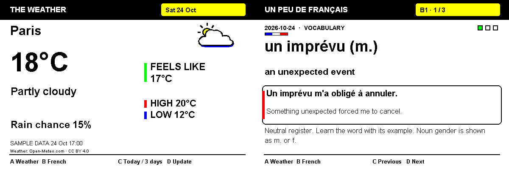

# Inky Home

A small local dashboard for **Raspberry Pi Zero 2 W + Inky Impression 4-inch Spectra 6**. Weather and 90 days of B1 French, controlled from four buttons or a phone. No cloud account, Docker, or frontend build is needed.



## Source and runtime locations

The app source is [avpa11/inky](https://github.com/avpa11/inky). On the author's Mac,
the primary checkout is `~/Documents/projects/inky`. This app is separate from
[Pimoroni's Inky driver](https://github.com/pimoroni/inky).

On the Pi, `~/inky-home/current` points to the active application release,
`~/inky-home/data` stores settings and progress, and `~/inky` is the separately
cloned Pimoroni driver repository. Deploy from the Mac checkout; don't put app
files inside the driver's repository.

## Power off and restart

The installed systemd user service starts automatically after power returns,
even without an SSH login. The I2C driver is loaded from
`/etc/modules-load.d/inky-home.conf`. Saved city, selected app, lesson progress,
and cached weather survive restarts. Allow time for boot, Wi-Fi reconnection,
and the first display refresh. French and the last weather cache work offline.

When possible, run `sudo poweroff` and wait for shutdown before unplugging power.
The e-ink image remains visible while the Pi is off. After reconnecting power,
open `http://small.local:8080`; a router may assign a different numeric IP.

## Try it on your Mac

```sh
git clone https://github.com/avpa11/inky.git
cd inky
python3 -m venv .venv
source .venv/bin/activate
python -m pip install -e .
python -m inky_home --display preview --sample-weather --data-dir var-preview
```

Open **http://127.0.0.1:8080**. If that port is occupied, add `--port 8081` and open port 8081 instead. The sample forecast is clearly labeled and never used as a fallback for real weather. Preview mode imports no GPIO or Inky packages. To test live forecasts, omit `--sample-weather` and use a separate `--data-dir var-live`.

To access the Mac preview from a phone on the same Wi-Fi, add `--host 0.0.0.0` and use `http://YOUR_MAC_LAN_IP:8080`. Allow incoming connections if macOS asks.

The preview is the last successfully displayed screen. Web controls remain available during hardware refreshes. A real screen may take around 12 seconds to update and will flash as part of its normal refresh. Preview mode simulates the controls without that delay.

## First installation on the Pi

Keep VS Code **Remote SSH disconnected**. Edit the source locally and transfer it with ordinary SSH/rsync. Raspberry Pi OS Bookworm or later and Python 3.9+ are required; Python 3.11+ is recommended.

1. Inspect the board **before installation**:

   ```sh
   ./scripts/inspect-pi.sh user@small.local
   ```

   Review OS, load, memory, free disk, and the existing Pimoroni environment. Resolve persistent high load before installing. Keep at least 300 MB free for installation and more for normal OS updates. A typical running service is much smaller than VS Code Server. Do not run cleanup commands blindly.

2. In a regular SSH session, complete Pimoroni's installer if you have only cloned the repository:

   ```sh
   cd ~/inky
   ./install.sh
   ```

   Enable interfaces and reboot if prompted. Follow the official guide for SPI chip-select configuration if necessary. Never attach/remove the display while the Pi is powered. Install these small OS dependencies if they are missing:

   ```sh
   sudo apt-get update
   sudo apt-get install -y python3-venv python3-dev build-essential fonts-dejavu-core rsync
   ```

   If the I2C buses are enabled but `/dev/i2c-*` files are missing, load the
   userspace driver and keep it enabled across reboots:

   ```sh
   sudo modprobe i2c-dev
   printf 'i2c-dev\n' | sudo tee /etc/modules-load.d/inky-home.conf
   ```

   Your user needs access to `/dev/gpiochip*`, I2C, and SPI. On Raspberry Pi OS this normally means `gpio`, `i2c`, and `spi` groups. If missing, use `sudo usermod -aG gpio,i2c,spi "$USER"`, then log out and reconnect.

3. From your Mac, deploy:

   ```sh
   ./scripts/deploy.sh user@small.local
   ```

   Each deployment uploads a separate release, installs a virtual environment, preserves the previous release, and restarts a **systemd user service**. `sudo loginctl enable-linger` lets the service start at boot without an SSH login. Installation may prompt for your Pi password. The service runs as your ordinary user, never as root.

4. Open **http://small.local:8080** (or `http://PI_IP:8080`) on your phone or laptop. Search for a city, select a match, and choose units/timezone. A city change defaults the timezone to that city; a manual timezone preference can be saved afterward.

### SSH host-key changes

After an OS reinstall, verify the new key through a trusted connection or local console with `ssh-keygen -lf /etc/ssh/ssh_host_ed25519_key.pub`. Do not disable host checking. If using a separate verified file, scripts support:

```sh
INKY_KNOWN_HOSTS=/path/to/verified-known-hosts ./scripts/deploy.sh user@10.0.0.246
```

For unattended agent access, authorize your Mac's **public** SSH key on the Pi; never share your password or private key in chat.

## Controls

| Button | Weather | French |
|---|---|---|
| A | Show weather | Show weather |
| B | Show French | Show French |
| C | Today / next 3 days | Previous card |
| D | Fetch weather | Next card |

The 4-inch board uses **BCM GPIO 5, 6, 16, 24** for A–D (physical pins 29, 31, 36, 18). Buttons have 250 ms software debounce. No long-press actions. Actions during a refresh are combined into the latest desired screen; in-progress refreshes finish safely. Identical rendered images are skipped. Button errors appear in the web interface.

Weather uses colored sun, cloud, rain, drizzle, fog, snow, and storm illustrations, including one per forecast day. The simpler layouts keep pure black text and stronger outlines, with all six inks used for accents: yellow date/card badges, red/blue high-low markers, green indicators, and French tricolor details. Screens are mapped to the exact six-color ink palette with no dithering, including solid glyph strokes, so the browser preview and panel receive the same colors.

Weather is fetched hourly, with a one-minute manual refresh limit and five-minute retries after failures. The service keeps the last successful forecast, labels it stale after an hour or a failed request, and never displays another city's cache. Missing fields use a dash. Sample and live caches are isolated. Weather dates and forecast timestamps use the selected city’s local time; the configurable timezone controls French rollover. Current precipitation probability comes from the forecast hour matching the current weather reading; daily views show the daily maximum.

French is fully offline: **90 sets / 270 cards**, at B1 level, with English explanations. Thirty grammar topics return at 30-day intervals with new examples. Nouns include gender; usage notes indicate register. The course begins on first startup, switches at 07:00 in the configured timezone, and repeats after day 90. You can change the rollover time, browse past days, or return to today's set. A daily rollover returns French browsing to today's first card, without changing the selected app. Reboot preserves the chosen app and card. Lessons are authored study material; they do not certify CEFR attainment.

## Updates, rollback, and logs

After editing locally, run `./scripts/deploy.sh user@small.local` again. Settings and weather/French progress live separately in `~/inky-home/data/home.sqlite3`. Releases are under `~/inky-home/releases`; retained releases are not deleted automatically. Check disk space before updates and keep the current and previous release when removing old ones.

On the Pi:

```sh
systemctl --user status inky-home
systemctl --user restart inky-home
tail -n 80 ~/inky-home/data/home.log
bash ~/inky-home/current/scripts/rollback.sh
```

Logs rotate at 500 KB with two backups. Standard service output is suppressed to avoid duplicate unbounded logging. For a startup problem before file logging is initialized, stop the service and run its command in the foreground:

```sh
systemctl --user stop inky-home
~/inky-home/current/.venv/bin/python -m inky_home --display hardware --host 0.0.0.0 --data-dir ~/inky-home/data
```

After diagnosis, exit the foreground process and start the service again. Only one process may own the display/GPIO. Back up the data directory while the service is stopped; restore it with the service stopped too. There are no schema migrations in v1, so rollback uses the same data.

## Verification

```sh
python -m unittest discover -s tests -v
```

Tests cover all 270 card renders, long city names, absent forecast fields, units, API validation, timezone/DST rollover, restarts, cache isolation, provider outages, city changes in flight, weather rate limiting, and responsive controls with serialized/coalesced refreshes.

On the Pi, also verify A–D individually, update the real panel, disconnect internet and check cached weather/French, and reboot to confirm automatic service startup. These hardware checks cannot be replaced by Mac preview tests.

## Architecture / adding an app

- `service.py`: persisted state, scheduler, independent weather and display workers. Locks cover short state changes; never network or hardware I/O.
- `weather.py` and `lessons.py`: data adapters; `render.py`: RGB 600 × 400 screen renderers. `display.py`: hardware/preview output and GPIO edges.
- `web.py`: local JSON endpoints and PNG preview; plain HTML/CSS/JS frontend. Waitress serves one process with four HTTP threads.

Add an app's data adapter and renderer to `SCREENS`, then add its selection/action handling and controls. Arbitrary uploaded code is not supported. The 4-inch resolution is checked at hardware startup; other Inky sizes need new layouts.

API: `GET /api/status`, `GET /api/preview.png`, `GET /api/cities?q=...`; JSON `POST /api/app {"app":"weather|french"}`, `/api/action {"button":"A|B|C|D"}`, `/api/settings` (partial settings), and `/api/french/day {"day":"YYYY-MM-DD"}` (or null for today). Errors use `{ "error": "…" }`, invalid input HTTP 400, manual rate limit 429, city search outage 502. Preview is 503 until the first successful render.

This app is for a **trusted home LAN** without login. Keep it off public networks; don't forward port 8080. State-changing requests require JSON and reject cross-origin browser controls. No continuous location tracking or external analytics. Weather and geocoding require internet; local UI and French do not. Time accuracy after reboot depends on the Pi's system clock/NTP.

## Sources

- [Pimoroni Inky installation](https://github.com/pimoroni/inky#installation) and [Spectra 6 button example](https://github.com/pimoroni/inky/blob/main/examples/spectra6/buttons.py).
- [Open-Meteo forecast API](https://open-meteo.com/en/docs), [geocoding API](https://open-meteo.com/en/docs/geocoding-api), [CC BY 4.0](https://creativecommons.org/licenses/by/4.0/). Geocoding uses GeoNames data. Open-Meteo's free endpoint is for noncommercial use.
